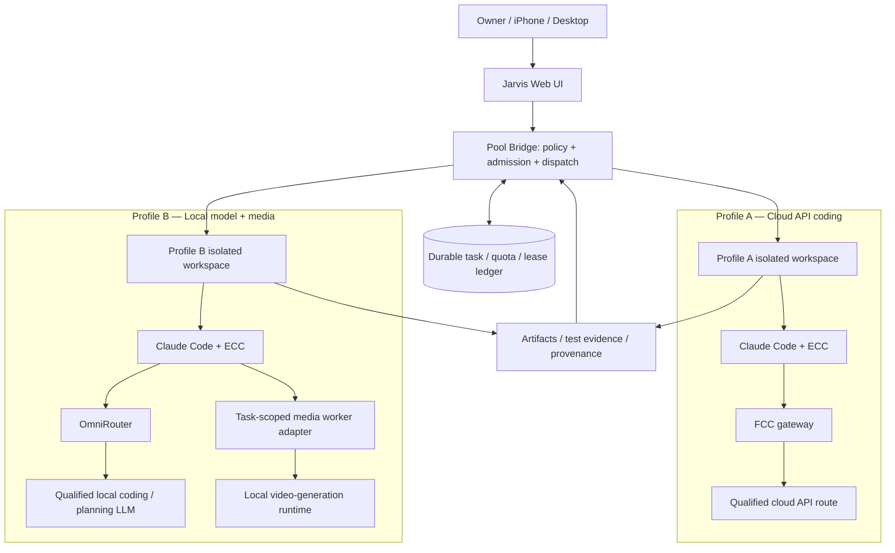

# Cloud Code dual-profile reference architecture — 2026-11-16

Status: **REFERENCE ARCHITECTURE / PRE-DEPLOYMENT DESIGN**. This document records the owner's clarified decision. No runtime has been deployed or qualified by this pass.

## 1. Binding architecture decision

The Cloud Pool has **two primary Claude Code execution profiles. Both profiles use Claude Code with the same official open-source ECC (Everything Claude Code) capability layer.** ECC is not a model provider, model router, or replacement for Claude Code. It supplies agent workflows, skills, hooks, rules and related harness capabilities.

- **Profile A — Cloud API coding profile:** Claude Code + ECC → FCC (Free Claude Code compatibility gateway) → explicitly qualified cloud API provider/model routes. Primary use: software engineering, code changes, tests, integration and DevOps.
- **Profile B — Local compute and media profile:** Claude Code + ECC → OmniRouter → qualified local language model for coding/planning; separately, a task-scoped media adapter/worker invokes the local video-generation runtime. Also supports software engineering, code changes, tests and DevOps. Its distinctive workload is local video/media generation.

ECC must be installed/configured independently in both Claude Code profiles. A common upstream version may be pinned, but each profile has its own plugin state, settings, hooks, workspace, task queue, credentials, model policy and audit stream. Do not share mutable Claude configuration state between profiles.

## 2. Terminology and component boundaries

| Component | Responsibility | Is / is not |
|---|---|---|
| Claude Code | Coding-agent CLI and tool execution harness | Agent runtime; not the provider gateway |
| ECC — Everything Claude Code | Claude Code plugin/toolbox: agents, skills, hooks, rules and workflows | Reusable harness layer; not an LLM or router |
| FCC — Free Claude Code | Anthropic Messages-compatible gateway/proxy to selected cloud providers | Profile A transport/provider adapter; not task authority or quota ledger |
| OmniRouter | Model routing gateway for Profile B | Route selector; must prove Claude Code protocol compatibility or use a reviewed adapter |
| Local LLM runtime | Serves the selected local coding/planning model | Inference backend; not a video-generation engine by default |
| Local media runtime | Executes video-generation workflows/models through a narrow task adapter | Separate media capability; not assumed to be exposed by OmniRouter |
| Jarvis Web UI | User-facing task entry, status and approval surface | Experience layer; not a privileged execution authority |
| Pool Bridge | Admission, policy, capabilities, quota reservation, routing decision, dispatch and audit | Sole privileged control-plane authority |
| Durable state store | Task ledger, idempotency, leases/fencing, quota ledger, outbox, checkpoints | System of record; not GitHub Actions concurrency |

**Important protocol distinction:** Claude Code expects an Anthropic-compatible interaction surface for its normal provider override path. Profile A's FCC adapter is intended to provide that. Profile B must not be assumed compatible merely because OmniRouter supports OpenAI-compatible APIs. Before qualification, prove the exact Claude Code request/stream/tool-call protocol through OmniRouter or introduce a separately reviewed Anthropic-compatible adapter. No protocol translation is approved by assumption.

## 3. Reference topology

The diagram is logical, not a claim that these services are currently deployed. Pool Bridge must reserve quota and issue a durable fenced lease before starting either profile. ECC does not receive Pool Bridge authority or provider credentials.

## 4. Profile contracts

### 4.1 Profile A — cloud API development

**Canonical logical path:** Jarvis → Pool Bridge → isolated Profile A → Claude Code + ECC → FCC → one admitted cloud provider/model route.

Allowed initial task classes: repository research and implementation; refactoring, code review and test design/execution; integration, CI and DevOps work; documentation and provenance capture.

Hard requirements:
- FCC runs in a trusted provider-side boundary separate from the untrusted Claude Code shell.
- Only the selected provider credential is injected into the trusted FCC runtime. Claude Code receives only the private FCC endpoint and a separate short-lived proxy credential.
- No provider keys in Claude Code process environment, ECC context, task envelopes, prompts, artifacts, cache, browser profile or logs.
- No secrets inheritance; no secrets for untrusted/fork-originated work.
- FCC Admin UI is not exposed; headless/private bind only; raw payload/SSE/CLI diagnostics remain disabled.
- Each route is disabled until account identity, quota domain, billing class, free-tier terms, model capability and exact adapter behavior are evidenced.
- No paid fallback. Unknown billing or quota means fail closed.

**Current blockers:** inspected FCC source Factix/fcc at commit 8ae7795961f05f425bd3e7418f85f2ccec7f4600 showed provider-key inheritance risk in _claude_child_env(). FCC source lineage/install provenance also needs resolution. Profile A is therefore NOT QUALIFIED and must not receive real provider secrets until the isolation fix and provenance gates pass.

### 4.2 Profile B — local model and media

**Canonical logical path:** Jarvis → Pool Bridge → isolated Profile B → Claude Code + ECC → OmniRouter → local LLM; video jobs use Claude Code + ECC → bounded media-worker tool → local video-generation runtime.

Allowed initial task classes: code development, tests, refactoring and DevOps using the selected local coding model; local media/video workflow planning and generation; media job preparation, monitoring, cancellation and artifact/provenance capture.

Hard requirements:
- Separate OS/process identity or equivalent strong isolation, workspace, home/config directory, queue, policy and audit from Profile A.
- OmniRouter must be private-network/loopback only unless a separately reviewed authenticated boundary is designed.
- The selected local coding model must be explicitly qualified for Claude Code tool use, streaming, context limits, stop reasons and cancellation. An OpenAI-compatible endpoint alone is insufficient proof.
- The video-generation engine is a separate capability and resource pool. Do not claim OmniRouter itself performs video diffusion/generation unless its pinned implementation and the selected model actually demonstrate that capability.
- Media worker receives only task-scoped input files and output directory; bounded duration, resolution, frame count, disk, memory/VRAM and wall-clock limits; cancellation and cleanup are mandatory.
- No cloud fallback, no paid fallback, and no silent upload of local media. If local capacity is unavailable, fail closed and report unavailable.
- Preserve source/output provenance, model/runtime versions, workflow parameters and artifact digests.

**Current blockers:** OmniRouter exact implementation/version and Anthropic protocol compatibility are NOT VERIFIED; local host identity, GPU/VRAM, model inventory, media runtime, capacity and isolation are NOT VERIFIED. Profile B is NOT QUALIFIED.

## 5. Shared ECC policy across both profiles

Canonical upstream:
- Repository: https://github.com/affaan-m/ECC
- Repository ID: 1136590548
- Default branch: main
- Observed source HEAD at review: d2ef2680594f9a17526a6e1a2e18b3d242c5d17b
- README blob read from main: d8017086ca85d2e851ef2e0c88470b0b09dc3d4d
- Upstream declares MIT license and documents the Claude Code plugin identifier ecc@ecc.

Use the official upstream only. Pin an immutable commit/release and verify source digest before installation; do not install third-party mirrors or use a floating main in a qualified deployment. Use one official plugin installation path per profile; do not combine plugin installation with a full manual install that duplicates hooks or plugin-managed files.

ECC installation is a separate, per-profile deployment step:
1. Create isolated Claude Code profile directories and workspaces.
2. Install the same pinned ECC plugin into Profile A and Profile B independently.
3. Keep profile-specific settings, enabled skills/hooks and permissions explicit.
4. Audit every enabled hook, command, skill and MCP integration before allowing it to execute in a worker.
5. Disable unneeded network-capable integrations and any feature that violates Cloud Pool egress, credential or approval policy.
6. Run synthetic no-secret smoke tests in each profile before connecting FCC or OmniRouter.
7. Record ECC commit, Claude Code version, plugin manifest digest, enabled components and test evidence per profile.

ECC's open-source plugin is the candidate; any hosted/proprietary ECC service is outside this architecture and must not be enabled. ECC's MIT declaration is upstream evidence, not a substitute for review of bundled components, dependency licenses, hooks and runtime behavior.

## 6. Isolation and identity model

The following are independent identities and must not be conflated: Profile A execution identity; Profile B execution identity; ECC plugin/config identity per profile; provider credential reference; upstream provider account and quota domain; local host/model/runtime identity; task/lease identity; Jarvis owner identity and Pool Bridge issuer/capability.

Provider credentials never cross into Profile B. Local model access never implies authority to read Profile A credentials. Neither Claude Code profile can mint Pool Bridge capabilities, approve its own work, change global quota policy, or dispatch another worker without an authorized task envelope.

## 7. Task routing policy

| Task class | Preferred profile | Secondary path | Admission rule |
|---|---|---|---|
| Coding / refactoring / tests | A or B according to task policy | Other profile if explicitly selected | Route only to a qualified model/profile |
| Cloud-provider-specific coding | A | None unless owner-approved | Exact provider/account quota reservation |
| Offline/private repository coding | B | A only after data-transfer approval | Local route preferred; no automatic upload |
| Video generation | B | None by default | Local media capacity and resource budget required |
| Security review | Independent role on a separate qualified route | Other profile for cross-review | Reviewer cannot be the sole author/verifier |
| Browser research | Isolated browser worker | Either profile may analyze sanitized evidence | Browser has no provider secrets; allowlisted sites |
| Documentation/provenance | Ephemeral worker | Either profile | Must cite immutable SHA and evidence |

The catalogue may contain many provider/model routes, but workers are instantiated on demand. Do not deploy 30 always-on Claude Code sessions. Keep the small control plane and durable state available; start only the profiles and specialist workers required by an admitted task.

## 8. Deployment sequence and gates

| Gate | Work | Acceptance evidence | Status |
|---|---|---|---|
| D0 | Freeze this dual-profile architecture and role boundaries | Owner decision captured in GitHub Context Window | DESIGN RECORDED |
| D1 | Resolve ECC source pin, review plugin/hooks/dependencies, create isolated profile manifests | Immutable source digest, license/dependency report, static policy review | NOT RUN |
| D2 | Qualify Claude Code + ECC alone in synthetic no-secret mode for both profiles | Version inventory, plugin load, hook audit, tool permission tests | NOT RUN |
| D3 | Fix FCC secret inheritance and verify source provenance | Regression test proves child env contains no provider credential variables; trusted process boundary | BLOCKED |
| D4 | Qualify one cloud route through FCC | Account/quota/billing evidence and end-to-end coding task | NOT RUN |
| D5 | Verify local host and model runtime; prove OmniRouter Claude Code compatibility | Host/GPU/model inventory, protocol/tool-call tests, no cloud fallback | NOT RUN |
| D6 | Qualify local media worker and video runtime independently | Synthetic/local test, resource limits, cancellation, provenance | NOT RUN |
| D7 | Qualify Pool Bridge admission, quota, fencing, recovery and cross-profile routing | Adversarial tests and durable ledger evidence | NOT RUN |
| D8 | End-to-end owner task through each profile and independent review | Exact SHA, run/job IDs, artifacts, test results and audit records | NOT RUN |
| D9 | Independent security/governance review and Contour A acceptance | Published acceptance report with all mandatory gates | NOT RUN |

No deployment should jump ahead of the relevant gate. Documentation does not authorize secret injection, provider calls, paid services, host changes or dispatch.

## 9. Current repository and governance snapshot

- Cloud Pool repository: https://github.com/VlDMlNSh/developer-cloud-pool
- Default branch: Основной
- Default HEAD observed: 35208f0ef28f0ac031a7acdf35fc90ccc9b16845
- Active ruleset: ID 26550182, enforcement active for refs/heads/Основной; PR required, deletion/non-fast-forward prohibited, review-thread resolution required, zero required approvals, no bypass actors.
- Branch endpoint reports protected=false; this is distinct from the active repository ruleset and must not be misreported as equivalent.
- PR #112 is OPEN/DRAFT/UNMERGED. It is a read-only owner /next event-envelope proof, not durable admission or dispatch authorization.
- Documentation branch is separate from default branch; changes in this document are not production code and do not imply merge or deployment.
- Gemini dispatch remains subject to its own approved-controller/security gates. This architecture document does not authorize dispatch.

## 10. Evidence and limitations of this pass

Verified in this pass: Cloud Pool repository metadata and default branch; default branch commit 35208f0ef28f0ac031a7acdf35fc90ccc9b16845; active ruleset ID 26550182 and its exact target/rules; PR #112 current open/draft metadata and its stated read-only boundary; ECC repository identity affaan-m/ECC, repository ID 1136590548, README content/blob and observed upstream HEAD d2ef2680594f9a17526a6e1a2e18b3d242c5d17b; FCC compatibility and secret-inheritance source assessments from the referenced Cloud Pool reports.

Not verified / not run: no ECC installation in either profile; no Claude Code runtime, FCC, OmniRouter, local model, GPU host or media runtime launched; no API key or secret value read; no provider/model calls, Gemini dispatch, worker dispatch or deployment; no CI run was triggered for this documentation-only pass; no Contour A qualification or acceptance.

## 11. Canonical references

- Cloud Pool Context Window: https://github.com/VlDMlNSh/developer-cloud-pool/blob/docs/cross-chat-continuation-2026-11-06/docs/context/GITHUB-CONTEXT-WINDOW.md
- Worker topology: https://github.com/VlDMlNSh/developer-cloud-pool/blob/docs/cross-chat-continuation-2026-11-06/docs/architecture/ON-DEMAND-WORKER-POOL-TOPOLOGY-2026-11-16.md
- FCC provider compatibility matrix: https://github.com/VlDMlNSh/developer-cloud-pool/blob/docs/cross-chat-continuation-2026-11-06/docs/architecture/FCC-PROVIDER-COMPATIBILITY-MATRIX-2026-11-16.md
- FCC secret isolation assessment: https://github.com/VlDMlNSh/developer-cloud-pool/blob/docs/cross-chat-continuation-2026-11-06/docs/reports/2026-11-16-fcc-github-secrets-no-admin-ui-assessment.md
- ECC upstream: https://github.com/affaan-m/ECC
- FCC upstream candidate: https://github.com/Factix/fcc
- Canonical MediaHub map (reference only; Contour B remains deferred): https://github.com/VlDMlNSh/mediahub-os/blob/docs/mediahub-chat-tree-map-20261012/docs/architecture/MEDIAHUB-CHAT-TREE-MAP.md
