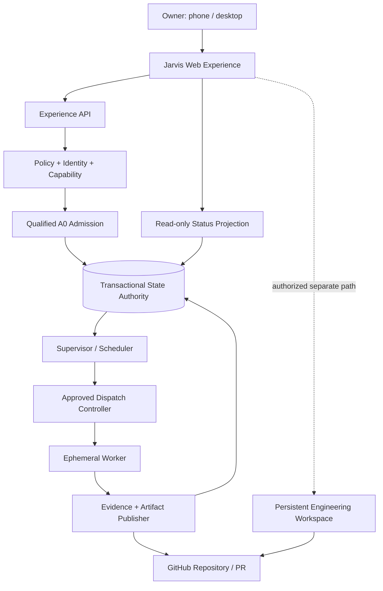
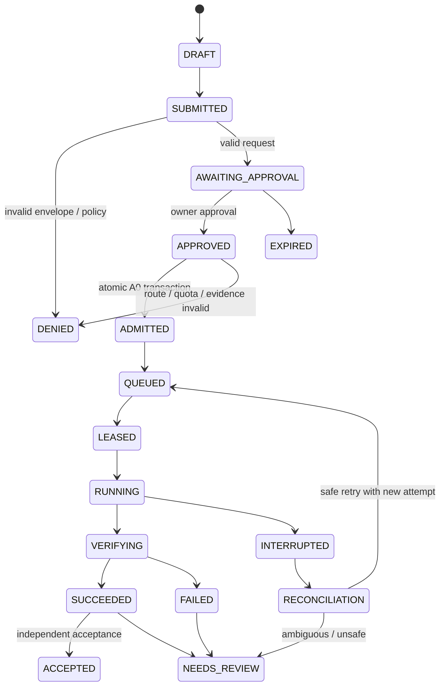

# Cloud Development Pool — Reference Architecture 1.0

**Status:** CANONICAL TARGET ARCHITECTURE / NOT DEPLOYED / NOT ACCEPTED  
**Date:** 2026-11-17  
**Contour:** A only  
**Baseline:** GitHub default branch `Основной` at `35208f0ef28f0ac031a7acdf35fc90ccc9b16845`  
**Scope:** Cloud Development Pool only. MediaHub OS / Contour B remains deferred.

> This document is the single normative system-level architecture. It defines intended boundaries, data ownership, protocols, failure behavior, and qualification gates. It does not convert designs, local proofs, successful CI, or open PRs into deployed capabilities. Detailed contracts linked below remain authoritative for their specific protocol fields and invariants. If an implementation conflicts with this document, fail closed and reconcile through an ADR before changing behavior.

## 1. Executive decision

Build Cloud Development Pool as a **governed engineering control plane with pluggable, isolated execution adapters and one persistent user workspace**.

Do not build a new general-purpose agent framework, model runtime, browser engine, IDE, or database abstraction where a mature component already satisfies the requirement. Own only the thin integration layer that enforces project-specific identity, authority, quota, task, evidence, and acceptance rules.

The platform has two physically and logically distinct compute classes:

1. **Ephemeral execution workers** — GitHub-hosted jobs or other explicitly qualified short-lived workers. A worker receives one bounded task, executes in an isolated environment, emits evidence, and is destroyed. It is not a server, durable workspace, or state database.
2. **Persistent Engineering Workspace** — a separately authorized host/service with durable files, Git worktrees, terminal and browser IDE access. It is a mandatory Contour A acceptance capability, staged after the initial GitHub-only Jarvis milestone; it is currently BLOCKED pending host, identity, network, storage, backup/restore, and free-tier qualification.

Jarvis is the single user-facing experience. It is not the authorization authority and never receives unrestricted worker or provider credentials.

## 2. Non-negotiable architecture invariants

1. **Contour ordering:** Contour A must be ACCEPTED before any Contour B / MediaHub OS product implementation.
2. **Fail closed:** missing, stale, ambiguous, untrusted, expired, revoked, or mismatched identity/evidence/capability/quota/approval means DENY. No fallback to an unqualified route.
3. **No implicit authority:** a UI action, issue label, model response, repository variable, credential presence, successful CI, or technical access does not grant authority.
4. **Immutable task target:** every task is bound to an exact 40-character commit SHA, repository ID, issue/task ID, profile, input digest, and policy version.
5. **Least privilege:** each workflow/job/service gets only the permissions and secrets needed for that single operation. Default worker jobs receive no provider credentials and read-only repository access.
6. **Account isolation:** provider accounts, issuer identities, credential handles, quota domains, cost classes, and usage ledgers are separate identities. Never merge accounts merely because they expose the same model.
7. **One transactional authority:** live task admission/claim/lease/outbox state has one selected transactional store. GitHub Issues, Actions, artifacts, and logs are projections/evidence, not competing locks or authoritative mutable state.
8. **No secrets in artifacts:** artifacts, issues, logs, Git, prompts, and model output contain only opaque references and redacted metadata. Never persist raw tokens, keys, cookies, or authorization headers.
9. **No false qualification:** PLANNED, IMPLEMENTED, CI PASS, locally tested, hosted smoke, QUALIFIED, and ACCEPTED are distinct statuses.
10. **No paid fallback:** no paid tier, billing workaround, payment-card workaround, or automatic paid model/provider fallback.
11. **Reproducibility:** pin code, action references, tool versions, schemas, policy revisions, and source evidence. Record exact target and execution SHAs separately.
12. **Human approval remains explicit:** owner approval is single-use, bound to a canonical immutable envelope, and consumed only inside the atomic admission transaction.

## 3. System context and trust boundaries

### 3.1 Trust zones

| Zone | Components | Trust assumption | Allowed authority |
|---|---|---|---|
| User edge | Jarvis Web, browser session | Untrusted input boundary | Authenticated task requests and approvals only |
| Experience API | Hono or equivalent thin API | Trusted only after identity and policy checks | Read projections; request admission; no direct execution |
| Governance | Issuer, capability, route registry, A0 | Trusted policy boundary | Decide whether an exact envelope is admissible |
| State authority | Transactional database | Trusted for atomic state transitions only | Approval consumption, task/attempt/lease/outbox state |
| Dispatch | Approved GitHub controller | Narrow workflow authority | Dispatch only allowlisted profiles after verifying immutable admission |
| Worker | Ephemeral hosted job | Untrusted execution result until verified | One task, bounded paths/commands/network, no general control-plane writes |
| Provider boundary | Provider-specific adapter/gateway | Isolated per account and quota domain | Only the exact qualified model/account route |
| Workspace | Persistent host and remote IDE | Separate high-risk zone | Owner-authorized interactive development; never Gemini dispatch |
| Evidence | GitHub commits, PRs, artifacts, audit | Evidence is immutable or digest-bound | Verification and review, not authority by itself |

### 3.2 Authority separation

- **Jarvis:** user experience and task orchestration requests; cannot mint issuer credentials, qualify routes, override quotas, or self-approve.
- **A0 / Admission Authority:** validates owner, repository, immutable target, profile, capability, approval, route evidence and quota eligibility.
- **Supervisor:** claims only admitted work using a durable fenced lease; cannot invent a task or broaden permissions.
- **Dispatch Controller:** verifies the admission receipt and dispatches only an allowlisted workflow/profile; no arbitrary workflow names or caller-supplied shell.
- **Worker:** executes a bounded envelope; cannot modify admission, approval, quota, route qualification, or project governance.
- **Provider Adapter:** uses one exact credential handle/account identity and returns redacted usage evidence; cannot select a different account silently.
- **Evidence Verifier:** validates output provenance and acceptance criteria; does not grant execution authority.
- **Owner:** approves sensitive actions and accepts the final Contour A evidence package.

## 4. Canonical component model

| Component | Responsibility | Owns | Must not own | Status on 2026-11-17 |
|---|---|---|---|---|
| Jarvis Web | Single phone/desktop console | UI session and user intent | Provider keys, dispatch authority | NOT DEPLOYED; related UI PRs unmerged |
| Experience API | Typed API and read projections | API schemas, session-to-request mapping | Durable claims or route truth | DESIGN / prototype work unmerged |
| Identity & Issuer | Authenticate user/service and issuer | Principal and issuer identities | Model selection or worker code | NOT QUALIFIED |
| Capability Policy | Bind actor, operation, repo, paths, profile and target | Versioned policy decisions | Secret values | PARTIAL CONTRACTS |
| Route Registry | Qualified provider/model/account/issuer/quota mapping | Immutable qualification revisions and revocation | Raw credentials | CONTRACT / qualification authority incomplete |
| Quota Ledger | Track per-account/per-domain budget and evidence | Reservations, observations, reconciliation | Account identity inference | Fail-closed work exists; hosted route not qualified |
| A0 Admission | Atomic approval + route evidence + task + attempt + outbox | Admission receipt | Provider calls or dispatch | Isolated D1 proof; not hosted/qualified |
| Transactional State | Durable task/lease/outbox/projection state | Single canonical state | Git source code | D1 is preferred candidate, not selected/hosted |
| Supervisor | Claim and schedule admitted tasks | Fenced lease lifecycle | Approval issuance or policy override | Scaffold; durable service not qualified |
| Dispatch Controller | Enforce dispatch boundary | Workflow run correlation | General arbitrary command execution | Gemini controller contract exists; gates must be checked per dispatch |
| Worker Adapters | Execute profile-specific tasks | Temporary process/workspace | Durable project state | One DSH profile scaffold; Claude/FCC install/runtime smoke only |
| Evidence Publisher | Bind results to run/task/SHA | Digests and evidence references | Acceptance decision alone | Partial |
| Persistent Workspace | Long-lived interactive files/terminal/IDE | Workspace filesystem and worktrees | Gemini or control-plane secrets | BLOCKED (Issue #118) |
| Audit & Observability | Append-only decision and execution trail | Event metadata and correlation IDs | Secret values | Partial |
| Acceptance Authority | Verify independent evidence and gates | Acceptance record | Self-certification by implementer | NOT RUN |

## 5. Task lifecycle — one canonical state machine

Task status and execution-attempt status are separate. A task may have multiple immutable attempts, but only one current fenced attempt may own execution at a time.

Normative lifecycle:

1. **Submit:** create a typed request. Reject arbitrary shell, arbitrary workflow names, mutable branch targets, unknown profiles, and unbounded path scopes.
2. **Normalize:** server constructs a canonical envelope; caller fields never override server-resolved identity or route registry values.
3. **Approve:** owner approval references the exact envelope digest, repository, issue, target SHA, profile, expiry, and single-use approval ID.
4. **Preflight:** authenticate principal/issuer; verify capability, route evidence, account/quota domain, evidence freshness, revocation, cost class, free-tier policy, and worker profile.
5. **Atomic admission:** one transaction consumes the exact approval and creates immutable admission, logical task binding, attempt, and one outbox intent. Any failed assertion rolls back everything.
6. **Queue:** committed outbox intent is visible to Supervisor. No worker starts before durable admission read-back.
7. **Lease:** Supervisor acquires a storage-backed lease with monotonically increasing fencing token, expiry, owner identity, task/attempt binding, and compare-and-swap semantics.
8. **Dispatch:** controller verifies current lease, admission receipt, target SHA, profile, allowlist, policy version, and dispatch gates. It records workflow run ID and exact run SHA.
9. **Execute:** one ephemeral worker performs only the granted operation under timeout/resource/network/path limits.
10. **Finalize:** worker publishes signed/digest-bound result metadata; finalizer checks lease fencing token and attempt identity before committing terminal state.
11. **Verify:** independent checks inspect artifact digest, commit ancestry, changed paths, tests, security results, and policy conformance.
12. **Accept:** only independent acceptance evidence can mark a task/contour ACCEPTED. CI success alone is insufficient.

## 6. Canonical task envelope

Every admitted task must bind the following fields (exact schema version is defined by the implementation contract):

- `schema_version`
- `task_id`, `logical_task_key`, `attempt_id`, `attempt_number`
- `owner_numeric_id`, `repository_id`, `repository_full_name`, `issue_number`
- `target_sha` (immutable 40-character commit SHA)
- `profile_id`, `capability_set`, `allowed_paths`, `allowed_operations`
- `issuer_id`, `principal_id`, `approval_id`
- `route_qualification_id`, `provider_id`, `model_id`, opaque `account_ref`, `quota_domain_id`
- `route_evidence_digest`, `registry_version`, `revocation_version`
- `policy_version`, `input_digest`, `acceptance_contract_id`
- `idempotency_key`, `created_at`, `expires_at`, `timeout_seconds`, `resource_budget`
- `dispatch_gate_revision`

The canonical serialization and digest algorithm must be versioned and tested. Unknown fields are rejected unless a newer schema explicitly permits them. Never include raw credentials or secret values.

## 7. Transactional state and durable recovery

### 7.1 Decision

Use exactly one transactional authority for mutable live control-plane state. **Cloudflare D1 remains the preferred implementation candidate** because the repository has isolated D1/Workers transaction proofs and the admission contract is written around a single D1 batch. It is NOT selected as a hosted production service until free-tier, identity, service deployment, transaction semantics, isolation, backups/export, restore, and independent security review are proven.

Do not operate D1 and PostgreSQL as co-equal task/lease authorities. If D1 fails qualification, issue an ADR selecting one alternative and migrate the complete state boundary before use.

### 7.2 State owned by the transactional authority

- Approval ledger and single-use consumption.
- Immutable admissions and logical task bindings.
- Immutable attempts and current-attempt pointer.
- Route qualification snapshots and revocation watermark.
- Quota reservations, usage observations and reconciliation status.
- Outbox and delivery attempts.
- Fenced leases, heartbeat/expiry and recovery decisions.
- Task projection version and dead-letter state.
- Audit event sequence and idempotency keys.

GitHub Issues are intake and human-visible projections only. Labels are not locks. Actions concurrency is not a distributed lease. Workflow run search is not proof that a dispatch did not occur.

### 7.3 Outbox / inbox / idempotency

- Admission transaction writes exactly one outbox intent.
- Dispatcher claims outbox rows conditionally and records a unique delivery attempt.
- Worker/controller inbox deduplicates on immutable task/attempt/delivery identity.
- Every retry uses deterministic idempotency keys.
- An ambiguous network result is reconciled by durable read-back; never blindly dispatch again.
- Dead-letter records preserve reason, event digest, attempt identity and recovery disposition without secrets.
- Projection updates are versioned and idempotent; projections may lag but cannot override authoritative state.

### 7.4 Lease fencing

Lease record includes task ID, attempt ID, worker identity, lease ID, fencing token, expiry, heartbeat sequence, and state. Every write by a worker/finalizer must present the current fencing token. A stale worker cannot finalize or publish accepted state after lease replacement. Lease expiry alone does not prove the prior process stopped; reconciliation must query correlated runs and choose NEEDS_REVIEW when execution outcome is ambiguous.

## 8. Model/provider routing and quota governance

### 8.1 Route identity

A route is not just a provider/model name. It is the tuple:

`provider_id + model_id + issuer_id + account_ref + quota_domain_id + credential_handle_ref + capability_profile + cost_class + qualification_revision`

Each account remains an independent quota and authority domain even when provider/model are identical. No silent cross-account failover.

### 8.2 Route qualification

A route is eligible only when immutable, issuer-authenticated evidence binds:
- exact provider and model;
- issuer and account reference;
- opaque credential handle;
- quota domain and cost class;
- supported capability profile;
- evidence reference and SHA-256 digest;
- observation time and expiry;
- monotonic revocation version;
- registry revision and qualification status.

Credential existence or a successful authentication check does not prove free quota. Free status must be backed by provider terms and current account evidence. Unknown pricing or quota means DENY for free-only operation.

### 8.3 Quota algorithm

1. Resolve exact account and quota domain from trusted registry.
2. Validate evidence freshness and revocation.
3. Read available quota and prior reservations.
4. Reserve budget atomically before provider use.
5. Enforce per-account concurrency, request and token ceilings.
6. Record actual usage and provider response metadata without secrets.
7. Reconcile estimate vs actual; release unused reservation.
8. On missing usage evidence, mark uncertain and block further spend for that account until reconciled.
9. Do not use another account unless a new admission explicitly authorizes that exact account/route.

### 8.4 Model gateway

A gateway such as LiteLLM may be evaluated as a transport/normalization component, but it must not become the source of identity, account entitlement, quota authority, or authorization. Multi-key routing/fallback must be disabled unless each key maps to an independently qualified account and the admission explicitly selects it. Do not deploy a gateway merely to avoid implementing the policy boundary.

Gemini dispatch remains exclusively through the approved repository controller `.github/workflows/gemini-batch-dispatch-controller.yml`. Never bypass it with direct API calls, local CLI, browser login automation, or another workflow. Before each dispatch, validate its input contract, security/governance gates, exact target SHA, secrets/variables existence without reading secret values, child run correlation, artifacts and digest. If any gate fails, status is NOT RUN with exact blocker.

Claude Code/FCC/ECC and Codex are independent execution adapters. Their installation or local runtime smoke does not qualify a provider route or agent task execution. No Anthropic paid API fallback is permitted.

## 9. Execution plane and worker profiles

### 9.1 GitHub-hosted workers

- Treat the 20-slot design as a logical planning ceiling, not guaranteed capacity or persistent machines.
- GitHub runner quotas, concurrency, image resources, billing rules and queue delay are external constraints and must be revalidated before commitments.
- Every task gets a fresh runner and bounded job timeout.
- Worker permissions are read-only by default; write operations go through a narrow evidence/PR publisher.
- Use separate jobs for untrusted input parsing and execution when permissions differ.
- Pin third-party actions to full commit SHAs; pin tool installers/releases and verify checksums/signatures where available.
- Restrict network egress where the platform supports it; otherwise document residual risk and do not run hostile/untrusted code with secrets.
- Do not assume runner isolation protects credentials deliberately injected into the job.
- No provider key is passed to general-purpose code workers.

### 9.2 Profiles are capability declarations, not dedicated machines

Profiles are dynamically scheduled by capability, trust level, cost/quota, OS/runtime compatibility, resource needs, and policy. Do not pre-install every toolchain into every runner.

Initial profile families:
- intake / policy / evidence;
- Gemini research, implementation, independent review (controller only);
- Claude Code toolchain;
- Codex CLI;
- browser automation;
- deterministic Playwright QA;
- repository analysis and documentation;
- unit/integration/build tests;
- security and provenance review.

Each profile must declare: exact tool versions, allowed commands, network destinations, repository permissions, secret policy, resource budget, timeout, output schema, cleanup, and acceptance tests. A profile is QUALIFIED only after a representative task, adversarial tests, cleanup, provenance and independent review.

### 9.3 Worker output contract

Worker output is untrusted until verified and includes:
- task/attempt/admission/lease IDs;
- target SHA and actual checkout SHA;
- worker profile/version and run/job IDs;
- changed path list and commit SHA (if any);
- test commands, exit codes and bounded logs;
- artifact names, sizes and SHA-256 digests;
- tool/source pin manifest;
- security findings and policy deviations;
- completion status and timestamp.

Never trust worker-supplied claims without checking GitHub run metadata, repository ancestry, artifacts, and exact-head checks.

## 10. Persistent Engineering Workspace

This is not a GitHub Actions runner. It is a separate long-lived service/host that provides:
- authenticated browser IDE and terminal;
- optional SSH/VS Code Remote access;
- persistent filesystem and Git repositories;
- one isolated Git worktree/container per task;
- backup, integrity checks and restore drills;
- per-user/per-task filesystem permissions;
- session expiry, audit and resource quotas.

**Current disposition: BLOCKED / NOT DEPLOYED.** Issue #118 records zero active SentinelX hosts, no authorized server #3, no Cloudflare zone/tunnel, Access not enabled, and no persistence/backup/restore evidence at its latest update.

No deployment may begin until owner-authorized host identity/capabilities, network ingress, identity provider, zero-trust policy, free-tier cost ceiling, persistent disk, backup/restore, workspace isolation, browser/SSH behavior, and independent review are verified. Do not use this host for Gemini. Integrate its status into Jarvis; do not create a competing UI.

Preferred component evaluation:
- code-server is a candidate browser IDE; keep authentication enabled and bind loopback-only behind a qualified identity-aware proxy. Use Open VSX where marketplace compatibility requires it.
- Git worktrees/containers are the isolation primitives; do not share a mutable working tree across concurrent tasks.
- Browser and desktop clients must open the same persistent workspace and pass a restore test before this is considered usable.

## 11. Jarvis Web experience

One responsive graphite interface for phone and desktop. It is a client to the control plane, not a second orchestration authority.

Required surfaces:
1. Chat / task creation.
2. Tasks / queue / attempts / status.
3. Agents / capability and qualification status.
4. Models / account identity / route qualification / quota (redacted).
5. Workspace / Git / terminal / IDE launch (only after qualified).
6. Artifacts / evidence / review.
7. Infrastructure / runner and service health.
8. Security / audit / approvals.

API requirements:
- OpenAPI schema with versioning and generated contract tests.
- Authentication and CSRF/session protections appropriate to deployment.
- Server-side authorization on every operation; UI visibility is not access control.
- Read APIs expose redacted projections only.
- Mutations require idempotency keys and typed payloads.
- Explicit approval UX displays repository, target SHA, profile, allowed paths, route/account identity (opaque), cost/quota class, and expected side effects.
- Mobile layout must support review/approval and evidence inspection, not only chat.

Hosting remains a separate decision. GitHub Actions cannot host a persistent web console. No paid hosting or billing workaround. Select a host only after verifying current free-tier terms, identity, TLS, WebSocket behavior, logs, limits and export/exit path.

## 12. Security baseline

### 12.1 Identity and authorization
- Distinguish owner, user session, service principal, issuer, worker identity, provider account and repository actor.
- Authenticate first; authorize each action against capability, scope, expiry and target SHA.
- Deny confused-deputy paths: Jarvis cannot borrow ASTRA A0 or MediaHub authority; worker cannot impersonate owner; provider response cannot grant capability.
- Approval is bound to canonical payload digest and single-use transaction.

### 12.2 Secrets
- Never fetch or print secret values during audits.
- Use secret-manager references/handles, not raw values, in records.
- Prefer short-lived job-scoped credentials and OIDC where supported.
- Do not expose provider secrets to pull-request code, fork workflows, untrusted browser sessions, or generic workers.
- Rotate/revoke on suspected disclosure; audit access metadata only.
- Redact logs and artifact manifests before publication.

### 12.3 Supply chain
- Pin Actions to immutable commit SHA.
- Pin external source repositories to immutable commit and package lock digests.
- Verify release signatures/checksums when published.
- Use minimal dependencies and reproducible lockfiles.
- Record SBOM/provenance for production adapters.
- Do not execute remote install scripts without pinning and integrity validation.

### 12.4 Network and isolation
- Explicit allowlist for egress destinations; deny provider/model egress from non-provider workers.
- Keep provider adapters separate from repository execution.
- Use ephemeral workspaces and per-task worktrees.
- Enforce file/path allowlists and reject symlink/path traversal escapes.
- Treat all model output, issues, PR comments, uploaded artifacts and browser content as untrusted data.
- Never run untrusted public PR code on a persistent host.

### 12.5 Governance
- Default branch remains protected by active ruleset; re-read exact rules before merges.
- Current ruleset has PR requirement and review-thread resolution but zero required approvals and no required status checks. This is not sufficient for independent acceptance.
- Require independent review and required checks before critical control-plane merges; update ruleset only through an owner-approved governance change.
- Dispatch remains disabled until governance, admission, durable lease, worker, provider route, persistence, and independent review gates are all met.

## 13. Observability, evidence and audit

Every request, admission, attempt, worker run, provider call, artifact and review shares stable correlation IDs. Record:
- event ID, actor/principal/issuer IDs;
- task/admission/attempt/lease/fencing IDs;
- repository ID, target SHA, profile and policy revision;
- route qualification ID, account/quota domain references (opaque);
- workflow run/job IDs and exact run SHA;
- start/end timestamps, status and bounded reason code;
- artifact digest and commit SHA;
- test/check names and conclusions;
- reviewer identity and acceptance decision.

Metrics:
- queue age and dispatch latency;
- admission allow/deny reasons;
- lease expiry, duplicate delivery, reconciliation and dead-letter counts;
- per-account reserved/actual/uncertain quota;
- worker duration, resource use, failure and retry rates;
- artifact verification and independent acceptance coverage.

Never include raw credentials, session cookies, authorization headers, private prompts, or unnecessary personal data in logs. Retention and deletion policy must be defined before production.

## 14. Reliability and failure semantics

| Failure | Required behavior |
|---|---|
| Admission transaction fails/ambiguous | No dispatch; durable read-back; NEEDS_RECONCILIATION |
| Approval replay | Reject or return the exact prior matching receipt; never consume twice |
| Duplicate event | Idempotent inbox/outbox; one execution owner |
| Lease expires | Fence old worker; reconcile correlated run before retry |
| Dispatch API timeout | Treat as ambiguous; search by immutable correlation; do not blindly dispatch |
| Worker crash | Mark attempt interrupted; new attempt only after safe reconciliation |
| Artifact missing/digest mismatch | Reject result; preserve evidence of failure |
| Provider quota uncertain | Freeze that account's new reservations pending reconciliation |
| Provider route revoked/expired | Deny new admission; do not silently switch account |
| State store unavailable | Read-only degradation; no admission/dispatch |
| Workspace host unavailable | No writes; preserve repository state; restore from verified backup |
| Governance/checks unavailable | No merge or dispatch |

At-least-once delivery is acceptable only when task execution is idempotent and fenced. Do not claim exactly-once external side effects; use idempotency keys and reconciliation.

## 15. Component reuse policy and upstream candidates

The platform should integrate mature components rather than reimplement them. Candidate status below is **evaluation only**, not an approval to install or deploy.

| Need | Upstream candidate | Intended use | Decision / caveat |
|---|---|---|---|
| Browser IDE | [coder/code-server](https://github.com/coder/code-server) | Browser VS Code-compatible workspace | Evaluate for Issue #118; authentication and loopback binding mandatory |
| Durable agent orchestration | [langchain-ai/langgraph](https://github.com/langchain-ai/langgraph) | Optional graph/checkpoint engine | Evaluate only if existing task lifecycle cannot meet requirements; never replace A0 authority |
| Agent coding runtime | [OpenHands/OpenHands](https://github.com/OpenHands/OpenHands) | Optional sandboxed coding executor | Evaluate as an adapter; not a control plane and not trusted with project secrets |
| Browser agent | [browser-use/browser-use](https://github.com/browser-use/browser-use) | Optional browser task adapter | Keep separate from deterministic browser tests; browser sessions are sensitive |
| Deterministic UI tests | [microsoft/playwright](https://github.com/microsoft/playwright) | Browser QA and reproducible UI checks | Preferred deterministic test tool where compatible |
| Model gateway | [BerriAI/litellm](https://github.com/BerriAI/litellm) | Optional provider transport/normalization | Do not rely on gateway routing as account/quota authority; disable unqualified fallback |
| Edge/runtime SDK | [cloudflare/workers-sdk](https://github.com/cloudflare/workers-sdk) | Build/test Cloudflare Worker/D1 adapters | Use only after current free-tier and deployment gates pass |

Before adoption, record: upstream commit/release, license, maintenance/security posture, dependency footprint, supported OS/runtime, isolation model, egress behavior, data handling, free-tier cost, and replacement/exit plan. Do not add dependencies simply because they are popular.

## 16. Architecture decisions (binding)

| ID | Decision | Rationale |
|---|---|---|
| ADR-001 | Jarvis is the only user-facing control console | One experience; avoid competing dashboards |
| ADR-002 | Control plane and execution plane are separate trust domains | Prevent agent self-authorization and secret spread |
| ADR-003 | GitHub Actions workers are ephemeral; never persistent hosting | Runner lifecycle and storage are not durable |
| ADR-004 | One transactional store owns mutable admission/lease/outbox state | Prevent split-brain and inconsistent locks |
| ADR-005 | D1 is the preferred candidate, not production-selected | Existing isolated proof; hosted free/security qualification outstanding |
| ADR-006 | GitHub Issues are intake/projection, not locks | Labels and workflow concurrency are not CAS leases |
| ADR-007 | Task identity is immutable and digest-bound | Reproducible execution and safe retries |
| ADR-008 | Fenced lease + outbox/inbox + idempotency are mandatory | Safe concurrency and ambiguous recovery |
| ADR-009 | Provider accounts and quota domains remain isolated | No hidden quota pooling or silent fallback |
| ADR-010 | Gemini uses only the approved controller | Preserve reviewed governance path |
| ADR-011 | Persistent workspace is a separate, staged plane and mandatory Contour A acceptance capability | Distinguish interactive host from short-lived runners; do not make it a first static-PWA launch dependency |
| ADR-012 | Reuse mature tools behind narrow adapters | Reduce custom code and maintenance burden |
| ADR-013 | Independent acceptance is separate from CI | Prevent implementer self-certification |
| ADR-014 | No paid fallback or unverified free-tier assumption | Respect project budget and user constraint |

Any change to these decisions requires a dated ADR with alternatives, consequences, migration plan, and explicit impact on existing contracts.

## 17. Delivery and qualification sequence

No phase is complete because its documents exist. Each phase requires runnable evidence.

| Phase | Deliverable | Exit gate | Current status |
|---|---|---|---|
| A0 — Architecture baseline | This reference architecture + reconciled Context Window + ADRs | One normative map, no contradictory status claims | IN REVIEW |
| A1 — Governance | Effective rules, required checks/review, safe dispatch gates | Exact ruleset read-back; no bypass; dispatch default false | PARTIAL / approval count 0 |
| A2 — Admission & state | Hosted transactional authority, atomic admission, route evidence | Concurrent/replay/rollback/revocation tests on hosted service | LOCAL PROOF ONLY |
| A3 — Lease & supervisor | Durable fenced lease, outbox/inbox, recovery | Crash/timeout/duplicate/fencing adversarial tests | NOT QUALIFIED |
| A4 — Worker | One real no-secret allowlisted task | Exact-head execution, cleanup, provenance, independent review | SCAFFOLD / partial profile proof |
| A5 — Route qualification | One genuinely free route, per-account quota | Provider evidence, live quota observation, cost cap, no fallback | NOT QUALIFIED |
| A6 — Jarvis Web | Authenticated phone/desktop UI connected to live read API | Browser/mobile tests, auth, CSRF, authorization, evidence UX | NOT DEPLOYED |
| A7 — Workspace | Persistent host, IDE, Git worktrees, backup/restore | Owner-authorized host + identity + isolation + restore + free cost; required before Contour A acceptance | BLOCKED (Issue #118) |
| A8 — End-to-end | Submit → approve → admit → lease → execute → verify → accept | Repeated end-to-end run and failure/recovery evidence | NOT RUN |
| A9 — Independent acceptance | Security/governance/operations review | All acceptance criteria passed with published evidence | NOT RUN |

### Contour A ACCEPTED requires ALL of the following

- Authenticated Jarvis Web usable from phone and desktop.
- At least one real, permitted task completes through the canonical pipeline.
- At least one provider/model route is genuinely qualified under free-tier constraints, with account and quota isolation.
- Admission and durable lease prevent replay, duplicate ownership and stale finalization.
- State survives service restart; backup/restore is tested.
- Persistent Engineering Workspace is qualified: desktop VS Code Remote SSH and browser code-server/Open VSX access the same authoritative filesystem; task worktrees are isolated; single-writer fencing is enforced; encrypted backup/restore is independently verified.
- Secrets are isolated and absent from logs/artifacts.
- Worker isolation, egress, path scope, timeout and cleanup are demonstrated.
- Evidence is bound to immutable source and exact workflow/job identities.
- Independent security/governance reviewer signs off.
- Required repository governance/checks are effective.
- Owner approves the published acceptance package.

Until then Contour A remains NOT ACCEPTED and Contour B remains DEFERRED.

## 18. Current blockers and next implementation order

1. Reconcile architecture documents and Context Window with current default HEAD and open PR evidence.
2. Resolve governance weakness: current ruleset has zero required approvals and no required status-check contexts; owner-approved governance update is needed before critical merge/dispatch.
3. Finish one hosted transactional state authority and prove admission + fenced lease + outbox recovery end-to-end. Do not keep local D1 proof as production status.
4. Qualify one worker profile and one free provider route; do not scale to 20 profiles first.
5. Deploy Jarvis Web only after authenticated read API and hosting/free-tier decision.
6. Unblock Engineering Workspace only after exact host/Access/storage evidence in Issue #118.
7. Run end-to-end and independent acceptance.
8. Only after ACCEPTED consider Contour B.

## 19. Normative source documents

This reference architecture does not erase detailed contracts. Keep these as the source of truth for their bounded protocol:

- [20-runner architecture](CLOUD-POOL-20-RUNNER-ARCHITECTURE.md) — runner sizing/profile inventory; 20 is a planning ceiling.
- [Jarvis hybrid platform architecture](JARVIS-HYBRID-PLATFORM-REFERENCE-ARCHITECTURE.md) — experience and deployment context; reconcile older statements against this document.
- [Supervisor and recovery](GITHUB-POOL-SUPERVISOR-AND-RECOVERY.md) — Supervisor/Worker contract.
- [Qualified Route Evidence and Atomic A0/D1 Admission](../contracts/QUALIFIED-ROUTE-EVIDENCE-AND-ATOMIC-A0-D1-ADMISSION.md) — route qualification and admission fields/invariants.
- [D1 atomic admission migration plan](../design/D1-ATOMIC-ADMISSION-MINIMAL-MIGRATION-PLAN.md) — implementation plan; local proof is not hosted qualification.
- [Durable Supervisor claim protocol](../decisions/2026-11-11-durable-supervisor-claim-protocol.md) — fenced claim target.
- [Engineering Workspace Issue #118](https://github.com/VlDMlNSh/developer-cloud-pool/issues/118) — host/access/storage qualification gate.
- [Claude Code + FCC + ECC PR #116](https://github.com/VlDMlNSh/developer-cloud-pool/pull/116) — install/runtime smoke evidence only; not route qualification.

## 20. Change control

- This file is the canonical system-level target architecture after merge to `Основной`.
- Keep a single current Context Window and dated reports/checkpoints as historical evidence.
- Architecture changes require ADR; implementation changes require tests and exact-head evidence.
- Update README, Context Window and component status in the same PR as material architecture changes.
- Do not change dispatch gates, secrets, production variables, provider credentials, hosting resources or branch rules as part of a documentation-only architecture pass.
- Do not claim deployment, qualification, acceptance, or readiness without the evidence listed above.

## 21. Owner-approved chat decisions and implementation reconciliation — 2026-11-17

This section consolidates the Engineering Workspace and executor decisions made during the 2026-11-17 architecture sessions. It is normative for the target, subject to the initial hosting boundary below. It does not claim any component is deployed.

### 21.1 Initial GitHub-only delivery boundary

The first Jarvis milestone must not depend on a physical/self-hosted machine, a persistent third-party service, Cloudflare Access, or paid hosting:

1. Start with a static, responsive GitHub-hosted PWA suitable for phone and desktop, exposing only redacted, read-only GitHub-native status (Issues, PRs, Actions and published evidence).
2. GitHub Pages/static assets and GitHub Actions runners are not an always-on API server. Do not put OAuth client secrets, installation tokens, provider credentials or privileged write tokens in browser assets.
3. Do not simulate authenticated write/approval/dispatch APIs in a static page. If a secure server-side OAuth/session/API cannot be delivered with an explicitly qualified GitHub-native capability, mark that capability BLOCKED and retain read-only behavior.
4. Cloudflare Workers/Pages, D1, Access, Tunnel and any external host remain candidates requiring separate current free-tier, identity, security, data-residency, backup/restore and owner-authorization qualification. No card, upgrade, paid fallback or billable provisioning.
5. The Persistent Engineering Workspace and authenticated hosted API are later staged capabilities, not dependencies of the first static-PWA milestone. They remain mandatory before Contour A can be ACCEPTED. Each requires explicit owner approval of the hosting boundary plus security, identity, persistence/recovery and free-cost evidence. This stage separation does not waive the final acceptance requirement.

### 21.2 Integrated Jarvis / Workspace / Execution model

Keep one Jarvis user experience and three distinct logical planes:

- **Jarvis Control Plane:** the sole responsive phone/desktop console; chat/task intake, status, approvals, agents, model/account/quota views (redacted), artifacts and audit. Jarvis requests work but is not A0, route authority or a worker.
- **Engineering Workspace Plane:** a separately authorized long-lived user development environment, distinct from ephemeral Actions runners and the transactional state store. It is not a first GitHub-only launch dependency, but qualification is mandatory before Contour A acceptance.
- **Agent Execution Plane:** isolated short-lived task attempts, each bound to immutable target SHA, typed profile, allowed paths/operations, account/quota identity, resource limits and evidence contract.

A single Jarvis console must expose status and launch links for qualified workspace/execution components; do not create competing dashboards or let a UI surface grant authority.

### 21.3 Workspace access and shared filesystem contract

Before Contour A acceptance, after the initial GitHub-only Jarvis milestone and all host/access/security gates are approved:

- The browser IDE and desktop IDE must use the **same authoritative persistent filesystem and Git repository**, not separate copies or sync-based replicas.
- Desktop path: official VS Code Desktop + Remote SSH through a verified SSH host key and an approved private/zero-trust transport. Never expose public SSH or disable host-key verification.
- Browser path: code-server (or a reviewed equivalent), authentication enabled, bound to loopback only behind an independently qualified identity-aware ingress. Use Open VSX where extension marketplace compatibility is required; do not bypass licensing or route code-server through Microsoft's proprietary Marketplace.
- Cloudflare Tunnel + Access is one possible ingress only after account entitlement, zone, identity provider, policy, origin JWT validation, WebSocket, free-cost and recovery gates are proven. It is not the same transport as VS Code Remote Tunnels; the latter is a separate Microsoft relay/trust dependency and needs its own approval.
- Do not deploy Coder or another workspace manager in parallel unless a measured requirement demonstrates code-server/Remote SSH is insufficient.
- GitHub Actions runners remain ephemeral and never become the persistent workspace host.

### 21.4 Concurrency, isolation and recovery

- Each agent/task receives a separate branch and Git worktree (and container where needed). No concurrent agents share a mutable checkout.
- Any shared mutable workspace has a single-writer lease with task/attempt identity, owner, expiry, heartbeat, monotonic fencing generation, conditional renewal/release and stale-generation rejection. A lease expiry alone does not prove the previous process stopped; reconcile before retry.
- Read-only observers may inspect a workspace without taking its write lease. Concurrent writers use separate worktrees.
- Backups must be encrypted, integrity-checked and independently restored. Workspace files, task state, audit records, provider credentials and backups are separate security domains.
- GitHub remains source-of-truth for code/docs; the one qualified transactional store (D1 remains a candidate, not a production selection) owns mutable admissions, attempts, approvals, leases, outbox and quota reservations. GitHub labels, PR comments and Actions concurrency are not distributed locks.

### 21.5 First executor profile — Claude Code + ECC + FCC

The first bounded CODE profile is installed and lifecycle-smoked on a standard GitHub-hosted ephemeral runner only:

- Claude Code native installer/version is pinned; do not use Anthropic API authentication or paid API fallback.
- FCC source commit: `eb92e4c07af0d6ad8881dce1cd958c3d072c27c5`; Python runtime: `3.14.10`; uv: `0.13.7`.
- ECC source commit: `e413166c50e85fb205b988b5e78874b5a88ea4d2`; only the selected `search-first`, `tdd-workflow`, and `security-review` modules are installed.
- FCC runtime binds explicitly to `127.0.0.1`, uses source-verified read-only readiness, and must shut down cleanly with no remaining listener.
- A synthetic `fcc-claude` bridge test proves only mock CLI handoff/provenance. It does not start a real Claude session, invoke a provider, qualify a free route, prove account entitlement/quota, or qualify task execution. FCC supports ordered/numbered provider key lists and `MODEL_FALLBACKS`; Cloud Pool must configure exactly one credential/account per FCC profile, disable key cycling and model/provider fallback, and maintain separate profiles and quota ledgers for separate accounts.
- Latest observed PR #116 head: `6d4a4c518d44aa4a79d8396390623f424499011a`. Exact-head runner proof [44086419084](https://github.com/VlDMlNSh/developer-cloud-pool/actions/runs/44086419084) and workflow/security validation [44086419002](https://github.com/VlDMlNSh/developer-cloud-pool/actions/runs/44086419002) both report SUCCESS. Runner job [134049913469](https://github.com/VlDMlNSh/developer-cloud-pool/actions/runs/44086419084/job/134049913469) completed all 14 steps successfully. This is installation + local loopback + synthetic mock evidence only.
- PR #116 remains OPEN/DRAFT/UNMERGED. Current-head independent reviews 5938684495 and 5938737463 are COMMENT (license and FCC fallback findings), not APPROVE or production authorization.
- Server #3 / external host execution is not authorized by this proof and remains blocked unless a separate Cloud Pool owner-approved host qualification exists.

### 21.6 Gemini and other model agents

- Gemini is optional supplementary execution, not a mandatory four-agent wave for every `/next`, not a first-release dependency, and not a Contour A launch gate.
- Any Gemini task must use only `.github/workflows/gemini-batch-dispatch-controller.yml` after exact-head controller, trusted admission, governance, durable lease/fencing/recovery, account identity, quota, artifact and independent review gates pass.
- Four credential slots or four key names do not prove four distinct Google accounts or independent quotas. Preserve opaque account identity and quota-domain evidence per credential. Do not mix quotas or silently fail over.
- No Gemini dispatch occurred in this pass; production dispatch remains disabled and NOT RUN. Do not run agents just to satisfy a historical four-agent wording.

- **Copilot:** optional adapter only; not part of the first CODE profile. Require verified free entitlement, explicit account/permission scope and spend controls before enabling; no paid fallback.

### 21.7 Explicit exclusions and status boundary

- Cloud Pool is the only repository being developed in Contour A. MediaHub OS is a separate consumer/product repository; no Contour B implementation is authorized before Contour A acceptance.
- Jarvis, ASTRA A0, provider issuers and MediaHub Product State Authority remain distinct authorities. Technical access does not imply permission.
- No secrets were read; no provider/model calls, real Claude session, Gemini dispatch, external host deployment or production dispatch occurred.
- The initial static/read-only Jarvis boundary is distinct from the later authenticated Workspace/API target. Workspace qualification is separate and currently BLOCKED by Issue #118.

### 21.8 FCC provider identity and fallback isolation

Pinned FCC source review found support for ordered provider-key lists, numbered key selection and `MODEL_FALLBACKS`; upstream tests demonstrate sequential use of different keys after 403/429 responses. Therefore:
- One FCC runtime profile may receive exactly one provider credential/account identity.
- Disable `MODEL_FALLBACKS`, numbered-key selection, key cycling and provider/paid fallback.
- Distinct accounts require distinct isolated profiles, opaque account references and independent quota ledgers.
- Never treat multiple key slots as proof of distinct upstream accounts or independent quotas.
- This is a required production configuration invariant; the current mock-only runner proof does not test a live provider configuration.
- Exact-head independent source review COMMENT [5938737463](https://github.com/VlDMlNSh/developer-cloud-pool/pull/116#pullrequestreview-5938737463) records this finding. Keep Issue #115 open until the configuration and free route/account/quota evidence are qualified.

## 22. Preserved chat-session source records and traceability

The following source records were migrated from the earlier PR #113 candidate into this PR #120 branch so that consolidation does not discard prior decisions or evidence:

- [Owner architecture freeze](CLOUD-POOL-OWNER-ARCHITECTURE-FREEZE-2026-11-17.md) — owner scope, no-paid constraints, optional Gemini and implementation order.
- [Engineering Workspace integration](CLOUD-POOL-ENGINEERING-WORKSPACE-INTEGRATION-2026-11-17.md) — shared filesystem, browser/desktop IDE, worktree and access design.
- [Earlier canonical architecture draft](CLOUD-POOL-CANONICAL-REFERENCE-ARCHITECTURE-1.0.md) — retained as historical/superseded source; this file is not the current system-level architecture.
- [Implementation roadmap](../roadmap/CLOUD-POOL-IMPLEMENTATION-ROADMAP-2026-11-17.md) and [master continuation prompt](../prompts/CLOUD-POOL-MASTER-CONTINUATION-PROMPT.md).
- [Archived prior Context Window](../context/GITHUB-CONTEXT-WINDOW-CHAT-ARCHIVE-2026-11-17.md) — verbatim earlier snapshot; current live context remains `GITHUB-CONTEXT-WINDOW.md`.
- Dated checkpoints are retained under `docs/checkpoints/`; dated implementation, runner, bridge, Workspace and security reports are retained under `docs/reports/`. Their status claims remain historical and must be reconciled with exact current refs before action.

All 30 changed paths from the earlier PR #113 candidate (excluding the active Context Window path, which is merged into the current context and preserved separately as an archive) are present in this PR #120 branch. The canonical architecture above contains the extracted normative decisions; source records remain for provenance and traceability.

PR #113 remains OPEN/DRAFT/UNMERGED until its disposition is explicitly resolved. Do not merge both documentation candidates as independent competing canonical sources. PR #120 is the single intended system-level architecture consolidation candidate.
