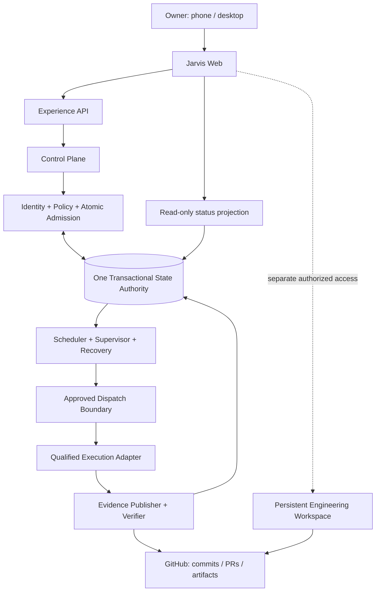

# Cloud Development Pool — Unified Realization Map

**Date:** 2026-11-17  
**Status:** PROPOSED IMPLEMENTATION BASELINE / REVIEW REQUIRED  
**Scope:** Contour A only  
**Parent architecture:** [Reference Architecture 1.0](CLOUD-POOL-REFERENCE-ARCHITECTURE-1.0.md)  
**Delivery controls:** [Architecture Assurance Addendum proposed in PR #122](https://github.com/VlDMlNSh/developer-cloud-pool/blob/docs/architecture-assurance-hardening-v2-2026-11-17/docs/architecture/CLOUD-POOL-ARCHITECTURE-ASSURANCE-ADDENDUM-2026-11-17.md)  
**Evaluation standard:** [Independent 10/10 Scorecard proposed in PR #122](https://github.com/VlDMlNSh/developer-cloud-pool/blob/docs/architecture-assurance-hardening-v2-2026-11-17/docs/architecture/CLOUD-POOL-10-10-INDEPENDENT-SCORECARD.md)  
**Source audit:** owner-supplied independent GitHub audit, reconciled against live refs available on 2026-11-17.

## 1. Decision

Retain the existing architecture and its core security invariants. Do not restart or replace the design. Consolidate implementation around one end-to-end route and make every new engineering pass produce executable behavior or verifiable evidence.

The platform is an **AI engineering operations system**: one governed user experience that selects qualified specialist tools, controls their authority and resources, supervises execution, preserves state, and verifies results. It is not a new agent framework and not a promise to run a fixed number of agents continuously.

The architecture is organized into six logical layers, but these are boundaries and responsibilities, not a requirement to deploy six separate services:

1. **Experience:** one Jarvis Web application for phone and desktop.
2. **Orchestration:** task planning, capability-based scheduling, supervision and recovery.
3. **Governance:** identity, capability, approval, route/account/quota policy and audit.
4. **Execution:** replaceable, individually qualified adapters for mature tools.
5. **Workspace:** a separately authorized persistent Engineering Workspace.
6. **State and Evidence:** one transactional execution-state authority, GitHub as durable source history, and immutable evidence.

Do not introduce a new service for every logical responsibility. Keep policy decisions and state transitions in the smallest number of trusted components that preserve clear authority boundaries.

## 2. What remains unchanged

The following are architectural invariants, not optional implementation preferences:

- GitHub remains the source of truth for source code, reviewed documentation, PR history and immutable revisions.
- GitHub Actions hosted runners remain the first elastic execution substrate; they are ephemeral workers, not persistent computers, a database or Kubernetes.
- Jarvis remains the only user-facing console and never becomes the authority that grants itself execution rights.
- Control Plane and Execution Plane remain separate trust zones.
- Supervisor/Worker, atomic admission, idempotency, fenced leases, outbox/inbox and ambiguity reconciliation remain required for production execution.
- Every task is bound to an immutable repository target SHA, canonical task envelope, policy revision and execution identity.
- Provider, model, issuer, account, credential handle and quota domain remain distinct. Four keys do not prove four accounts or four independent quotas.
- Fail-closed authorization, no paid fallback, no cross-account key cycling and no provider secrets in generic workers remain mandatory.
- Gemini remains exclusively behind the approved controller `.github/workflows/gemini-batch-dispatch-controller.yml`; this map does not authorize a dispatch.
- Independent verification and formal Contour A acceptance remain mandatory before Contour B.

## 3. Simplified logical architecture and one integration route

### 3.1 Canonical task route

`Jarvis → Experience API → Control Plane policy/admission → transactional state/outbox → Scheduler/Supervisor → approved dispatch boundary → qualified adapter/worker → evidence publisher/verifier → GitHub + read projection → Jarvis`

The route is logically sequential. It does not require a separate network hop or independently deployed microservice for Planner, Policy, Admission, Registry, Quota, Supervisor, Outbox, Projection and Recovery. Keep these as modules or transactionally bounded responsibilities until measured scale or a trust boundary justifies separation.

### 3.2 Authority boundaries

| Component | May do | Must not do |
|---|---|---|
| Jarvis | Collect intent, display status, request explicit approval | Mint identity, override policy/quota, dispatch workers directly |
| Experience API | Authenticate session, validate typed requests, expose redacted projections | Own durable leases or provider credentials |
| Control Plane | Resolve identity/capability/route, enforce approval and quota policy, create admitted work | Execute arbitrary worker code |
| Transactional state authority | Atomically persist admission, task/attempt, lease, outbox/inbox and quota reservation | Become a second source for Git history |
| Scheduler/Supervisor | Select eligible qualified profile, claim fenced work, reconcile outcomes | Invent tasks, grant approval, silently change account/route |
| Dispatch boundary | Start only an allowlisted workflow/profile after verifying admission | Accept arbitrary workflow names or shell from user text |
| Worker/adapter | Execute one bounded task in isolated environment | Change policy, quota, approval or task authority |
| Evidence verifier | Verify ancestry, paths, digests, tests and run correlation | Treat worker claims as trusted or self-accept Contour A |
| Workspace | Provide owner-authorized persistent interactive development | Act as Gemini execution host or shared unfenced worker filesystem |

## 4. Execution Pool and Engineering Workspace are separate systems

### 4.1 Cloud Execution Pool

- GitHub-hosted runners are short-lived, one-task execution environments.
- The “20 slots” concept is a planning ceiling only. Actual concurrency is dynamic and constrained by GitHub quotas, account limits, runner availability, workflow policy and per-profile budgets.
- The scheduler chooses a qualified profile by capability, trust level, OS/runtime compatibility, resource budget, allowed repository/path scope, provider route and account quota.
- Profiles are not dedicated machines. Do not preinstall every toolchain into every worker.
- A worker must report actual checked-out SHA, profile/tool versions, run/job IDs, changed paths, exit codes, artifact digests and cleanup evidence.
- A synthetic CLI, installer smoke or loopback lifecycle proof is not a real agent task or provider-route qualification.

### 4.2 Persistent Engineering Workspace

This is a separate long-lived service/host, not an upgraded GitHub runner. It provides durable files, Git worktrees, terminal, browser IDE and optional SSH/VS Code Remote access from phone and desktop.

Required controls include owner-authorized host identity, identity-aware ingress, persistent storage, per-task worktree/container isolation, single-writer fencing, backup and restore drills, audit, quotas and no-paid-tier guardrails.

**Current state: BLOCKED / NOT DEPLOYED.** Issue #118 records no active authorized server #3, no qualified Cloudflare Access/Tunnel path, and no persistence/restore proof in its 2026-11-17 evidence. No installation or deployment is authorized by this document. Gemini must not run on this host.

Workspace remains a distinct capability and explicit Contour A gate while it is in scope. Any decision to exclude it from the initial acceptance boundary requires explicit owner approval and a recorded scope change; it must never be represented as deployed.

## 5. State ownership: two durable domains plus immutable evidence

Do not conflate three different data lifecycles:

| Domain | Source of truth | Contents | Explicit exclusions |
|---|---|---|---|
| Execution/control state | Exactly one selected transactional database | Admission, approvals consumed, tasks, attempts, leases/fencing, outbox/inbox, quota reservations, reconciliation | Git history, source docs, arbitrary workspace files |
| Project/workspace state | GitHub for reviewed source/docs; separately qualified workspace storage for working files | Commits, branches, PRs, architecture decisions, durable working tree and backups | Mutable task lease authority |
| Evidence | Append-only or immutable digest-bound records/artifacts | Run/job IDs, target and checkout SHA, manifests, logs, test results, artifact hashes, reviews | Competing mutable task database |

D1 remains the preferred transactional candidate from existing proofs, not a production selection. PostgreSQL remains an alternative only through an ADR and a complete state-boundary migration. Never dual-write both stores as co-equal authorities. GitHub Issues, labels, Actions artifacts and concurrency groups are not transactional locks.

## 6. Capability-based scheduler, not fixed agent slots

The scheduler selects from declared and qualified capabilities, not hard-coded numbered seats.

A profile descriptor must include:

- profile ID and immutable profile revision;
- capabilities (research, coding, refactoring, testing, browser automation, security review, documentation);
- toolchain and version pins;
- trust tier and permitted input classification;
- OS/runtime and resource requirements;
- allowed repositories, paths and operations;
- network-egress policy and residual-risk statement;
- provider route/account/quota binding, if applicable;
- secret policy, timeout, concurrency and budget;
- output schema, cleanup contract and qualification evidence.

Candidate profile families: Gemini research/implementation/review through the approved controller only; Claude Code; Codex CLI; browser automation; Playwright QA; repository/research; build/test; security/provenance. These are candidates, not claims that every profile is available or qualified.

Three independent Gemini agents, when authorized, mean three distinct task envelopes, isolated contexts, execution identities and evidence chains. They are not three labels on one shared prompt or proof of three independent account quotas.

Do not create a generic marketplace or universal plugin SDK before at least two independently qualified adapters demonstrate a stable shared interface need.

## 7. Jarvis: one application, coherent surfaces

Jarvis is one responsive application and one API, not eight separate applications or a collection of vendor dashboards.

| Surface | User capability |
|---|---|
| Chat | Discuss work, define task intent and prepare typed task envelopes |
| Agents | View profile capabilities, qualification, availability and restrictions |
| Tasks | Queue, attempts, progress, blocked reasons, retries and history |
| Workspace | Open the same qualified persistent files, Git, terminal and IDE |
| Models | View provider/model/account references, route status and redacted quota evidence |
| Artifacts | Inspect diffs, test reports, outputs, manifests and digests |
| Infrastructure | View worker capacity, queue, service health and resource limits |
| Security & Audit | Review approvals, capabilities, policy decisions, events and provenance |

All mutations are authorized server-side. The interface never treats hidden controls as security. Mobile and desktop must both support status inspection, approval details and evidence review. Jarvis is not considered live until authentication, server-side authorization and the real API/state path are proven.

## 8. Mature component reuse policy

Prefer maintained upstream components over custom equivalents, but adoption is evidence-based. Every adoption requires an immutable upstream reference and a short decision record covering license, source provenance, maintenance/security posture, compatibility, permissions, network behavior, secret handling, free-tier/billing exposure, footprint, test fit, exit path and measurable acceptance test.

| Component | Intended role | Current decision |
|---|---|---|
| Claude Code | Specialist coding executor | Candidate adapter; current PR #116 proves bounded install/FCC lifecycle/synthetic bridge only, not a real provider-backed task |
| Codex CLI | Independent coding/testing adapter | Candidate; qualification NOT VERIFIED |
| agent-browser | Browser automation | Reuse candidate; verify browser availability, security boundary and license before enabling |
| Playwright | Deterministic browser/UI testing | Preferred QA primitive, not an autonomous authority |
| LangGraph | Complex stateful graph orchestration | Evaluation only; not a prerequisite for first release |
| Hono | Thin HTTP/API layer | Candidate; adopt only if it reduces integration cost and keeps policy centralized |
| code-server / Open VSX | Browser IDE for persistent Workspace | Candidate; authentication on, loopback behind qualified ingress; license/marketplace review |
| Git worktrees / containers | Per-task workspace isolation | Preferred primitives; fencing and filesystem isolation still required |
| D1 | Transactional execution state | Preferred candidate, not production-selected |
| PostgreSQL | Alternative transactional state | Mutually exclusive alternative selected only through ADR |

No popularity-based selection. No duplicate orchestration framework, browser engine, IDE, database abstraction or provider gateway without a demonstrated gap.

## 9. Security hardening required before real executor use

The independent audit's security concerns are treated as qualification blockers, not documentation footnotes.

### 9.1 GitHub-hosted runner egress

GitHub-hosted runner network egress must not be described as a hard sandbox unless an enforceable network boundary is demonstrated. Where strict egress blocking is unavailable, compensate by not injecting secrets, restricting workload to trusted code, separating untrusted parsing from privileged jobs, and recording residual risk. Never run hostile/untrusted code with credentials.

### 9.2 Executable and PATH trust

The current PR #116 environment wrapper filters child environment variables and validates absolute PATH entries, but absolute paths alone do not prove directory ownership or executable integrity. Before production use, qualify a trusted minimal PATH, reject writable/untrusted PATH directories, use verified absolute executable paths where feasible, pin the interpreter and launcher, and add adversarial tests for PATH shadowing, symlinks and executable substitution.

### 9.3 Installer and dependency provenance

The PR #116 Claude native installer is downloaded at runtime from a mutable vendor URL and invoked with a version argument. Version selection alone is not cryptographic pinning. Before qualification, verify a vendor-published signature/checksum or capture and independently verify an immutable installer digest, pin all upstream source commits and dependency locks, and fail closed on mismatch. Do not invent a checksum where the vendor does not publish one; record the limitation and decide whether the residual risk is acceptable.

### 9.4 Other mandatory controls

- least-privilege job permissions; no secrets in generic workers or untrusted PR execution;
- immutable action/tool/source pins and provenance manifests;
- path traversal, symlink escape and workspace-boundary tests;
- redacted logs/artifacts and short retention;
- process/listener cleanup and bounded time/resource use;
- replay, duplicate delivery, stale lease, revoked route and ambiguous-dispatch tests;
- independent review by a reviewer who did not author the evaluated change.

### 9.5 Claude Code + FCC + ECC evidence boundary

As re-read on 2026-11-17, PR #116 is OPEN/DRAFT/UNMERGED at head `6d4a4c518d44aa4a79d8396390623f424499011a`. Workflow runs `44086419084` (runner qualification) and `44086419002` (Pool Contract Validation) report SUCCESS on that head. The workflow includes FCC loopback lifecycle and synthetic CLI bridge checks. This is useful bounded no-secret evidence, but does not establish a real Claude session, a free provider route, independent quota, trusted runner egress, full PATH integrity, cryptographically pinned installer, persistent Workspace, or Contour A acceptance. Treat the above security gaps as BLOCKED pending explicit remediation and independent review.

## 10. One implementation sequence and exit criteria

| Step | Deliverable | Exit evidence | Must not be claimed |
|---|---|---|---|
| S0 — Baseline | One canonical architecture, task envelope, state/status model, authority map, implementation map | Validators and contradiction review on exact SHA | Runtime capability |
| S1 — Jarvis read path | Authenticated phone/desktop UI with redacted live pool/task projection | Auth/session tests, server-side auth negatives, browser evidence | Task execution |
| S2 — Transactional admission | One hosted free-tier state authority and atomic owner approval/admission/outbox | Hosted integration, replay/concurrency/rollback/restore tests | Worker execution |
| S3 — First no-secret worker | One deterministic allowlisted task on exact SHA | Exact run/job provenance, digest, test, cleanup, independent verification | Provider/model access |
| S4 — Supervisor/recovery | Fenced leases, outbox/inbox, retry and ambiguity reconciliation | Crash, stale-worker, duplicate and lost-response adversarial tests | Exactly-once external side effects |
| S5 — First real free route | One exact provider/model/issuer/account/quota route | Real bounded task, account/quota evidence, no fallback, security review | Other provider accounts |
| S6 — Persistent Workspace | Authorized host, Access, durable storage, isolation, restore | Phone/desktop/SSH/browser evidence and restore drill | GitHub runner persistence |
| S7 — Parallel execution | Multiple independent task envelopes and qualified profiles | Concurrency, isolation, quota, recovery and fairness evidence | Fixed 20-machine capacity |
| S8 — Contour A acceptance | Complete evidence package and independent review | All conjunctive acceptance gates, owner decision recorded | Contour B before acceptance |

This sequence reconciles the existing V0–V7 delivery addendum with the audit's request for a working product. S1–S4 are the first executable product path. Existing Claude/FCC/ECC and other profile qualification can proceed as bounded evidence work, but must not become a production dependency before S2/S4 security and state gates pass.

## 11. Current blocker register and next concrete pass

| Area | Live status at audit reconciliation | Next evidence |
|---|---|---|
| Reference Architecture 1.0 | PR #120 OPEN/DRAFT; head `35b47e0e0fd576dc0552934f733548a05cbcb435` | Independent review, exact-head documentation CI, merge under meaningful governance |
| Assurance/10-10 scorecard | PR #122 OPEN/DRAFT; head `4f5b2e9d5b7c434dcbd18d056fbaea6ee3f4b406`; mergeable=false at read | Reconcile dependent branch/base and exact-head CI; do not merge independently of its base |
| Claude/FCC/ECC | PR #116 OPEN/DRAFT; exact head above; two workflow runs SUCCESS | Resolve egress/PATH/installer provenance findings; independent security review; no provider route claim |
| FCC runtime Issue #117 | CLOSED | Its loopback lifecycle smoke is bounded evidence only |
| Synthetic bridge Issue #119 | CLOSED | Mock bridge is not a real Claude session or provider route |
| Persistent Workspace Issue #118 | OPEN / BLOCKED | Authorized host, Access ingress, storage, isolation and restore proof |
| Jarvis authenticated deployment | NOT VERIFIED / NOT DEPLOYED | Live auth + real API + phone/desktop verification |
| Transactional state / Supervisor | NOT QUALIFIED end-to-end | Hosted state authority, fenced leases, recovery and adversarial evidence |
| Free provider route | NOT QUALIFIED | One real exact account/issuer/quota route with no paid fallback |
| Contour A | NOT ACCEPTED | All conjunctive gates and independent owner acceptance |
| Contour B | DEFERRED | Prohibited until Contour A is ACCEPTED |

**Next engineering pass:** stop expanding architecture. Reconcile the current architecture/assurance PR stack and governance, then implement the smallest authenticated Jarvis read path against a read-only status projection (S1), or explicitly mark it BLOCKED if the required hosting/auth path is not available. Do not enable production dispatch or read secrets as part of that pass.

## 12. Change control

This map is the single implementation sequence beneath Reference Architecture 1.0; it does not create a second system architecture. Detailed protocol contracts remain authoritative for exact fields and state invariants. If this map and a protocol contract conflict, block the affected change and resolve by dated ADR. Historical documents remain immutable evidence and must be labelled historical, superseded or proposal; they are not competing current-state descriptions.

Any new framework, state store, worker profile, network boundary, authority or persistent service requires a component/architecture decision record and updates to this map, the reference architecture and Context Window in the same reviewed change.

---
This document is a proposal until independently reviewed and merged. It does not deploy services, qualify profiles, enable dispatch, read secrets, call providers or accept Contour A.
