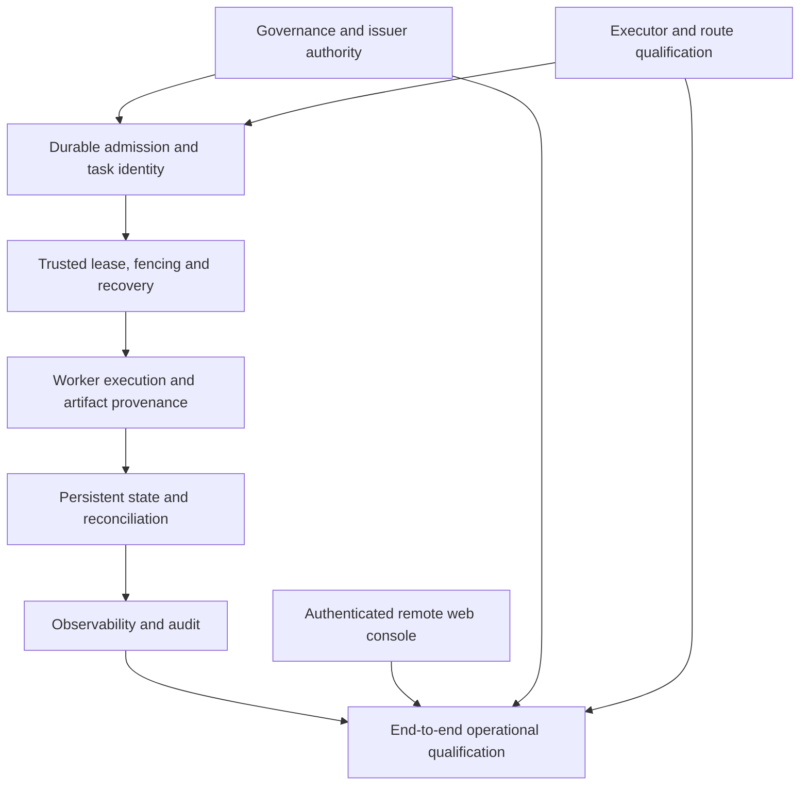

# Dependency Map and Critical Path

- Status: **INITIAL MANUAL MODEL / NOT AUTOMATED**
- Last assessed against Context Window Pass 50: 2026-11-23.
- Update after every material blocker closure or new dependency.

## Dependency graph (logical order)

Edges express prerequisite relationships, not proof of completion. The graph is a planning model and must be reconciled with live Issues/PRs before scheduling work.

## Current critical-path interpretation

1. **Resolve Pass 50 F-50-01**: remove caller-controlled lease time, introduce runtime-owned trusted clock provenance, fail closed on invalid/rollback time, and add adversarial tests.
2. Re-run D1 proof and Pool Contract Validation on the exact resulting PR merge-result SHA; inspect logs and test totals.
3. Complete lease/fencing/replay/recovery and issuer/controller provenance qualification.
4. Qualify the first executor and one genuinely free, account-isolated provider route under existing owner/security constraints.
5. Integrate durable admission, worker, outbox and recovery without blind retries or duplicate execution.
6. Qualify persistent state, artifact provenance, backup/restore and repeated operation.
7. Deliver authenticated read-only web console backed by real pool state.
8. Complete security/governance and end-to-end acceptance evidence; only then consider Contour A ACCEPTED.

This is a dependency-oriented sequence, not a promise of elapsed time. Current exact blockers and issue/PR references must be refreshed from GitHub before each pass.

## Parallelizable work

Work may proceed in parallel only when:
- it does not share mutable state or authority;
- the immutable base and interface contract are fixed;
- it cannot invalidate the same acceptance evidence;
- no step depends on unqualified runtime or credentials;
- merge order and stacked-PR ancestry are explicit.

Examples: documentation consistency checks, independent static contract review, isolated negative-test design, and read-only component research. Do not parallelize two edits to the same migration/lease state machine without an explicit integration plan.

## Critical-path accounting

For each open task record: predecessor IDs, owner/agent role, estimated active engineering hours as a range, external wait, earliest start condition, evidence required, and blocker. Do not sum parallel tasks as calendar time. Compute calendar duration from the longest dependency chain plus evidenced external waits; do not invent velocity from pass count.

## Change control

A newly discovered HIGH/CRITICAL finding may reorder the path immediately. Record why, which previous estimate is superseded, and which dependent tasks are paused. A task is removed from the critical path only after its acceptance evidence is verified, not when its PR is opened or code is written.
